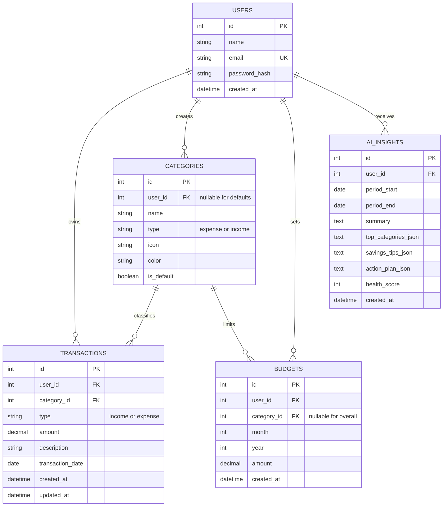

# 🪙 Smart Expense Tracker & AI Financial Advisor

> **Full-Stack Web Application** built with Python (Flask), SQLite/SQLAlchemy, Modern Bootstrap 5, Chart.js, and Google's Gemini 3.8 Flash API.  
> Fully optimized for mobile screens, tablet viewports, and desktop monitors.

---

## 🌟 Key Features

### 📱 1. Mobile-First & Responsive UX
- **Mobile Bottom Navigation Bar**: One-thumb navigation across Home, Transaction History, Quick Add (+), Budgets, and AI Advisor.
- **Floating Action Button (FAB)**: Floating quick-add trigger on mobile devices for 1-tap expense logging.
- **Dual Presentation Layer**: Clean card-based feed on mobile screens and dense sortable tables on desktop.
- **Touch-Friendly Controls**: Touch targets $\ge$ 48px, native date pickers, and numeric decimal keyboards.

### 🔐 2. Authentication & Data Isolation
- User registration, login, remember-me sessions, and logout powered by `Flask-Login` and `Werkzeug` secure hashing.
- Strict multi-tenant data isolation: every database query is scoped to the authenticated user's ID.
- **1-Click Portfolio Demo Access**: Instant login as a pre-populated test user (*Alex Morgan*) without registration.

### 💰 3. Transaction Management
- Full CRUD (Create, Read, Update, Delete) for Income and Expense transactions.
- Live search by description, filters by Type (All / Income / Expense), Category, and Date range.
- Sorting by date or amount, with clean server-side pagination.
- Currency display in Indian Rupees (**₹**) with decimal precision.

### 🏷️ 4. Category Management
- **10 Default Expense Categories**: Food & Dining, Rent & Housing, Transportation, Shopping, Entertainment, Healthcare, Education, Utilities, Travel, Other.
- **5 Default Income Categories**: Salary, Freelance, Business, Investments, Other Income.
- **Custom Categories**: Users can create their own custom categories with custom icons and hex colors.
- Safeguards to prevent accidental deletion of default categories or categories linked to transactions.

### 🎯 5. Monthly Budgets & Overspending Alerts
- Monthly limits by category or overall global spending budget.
- Automatic utilization tracking against actual expenses for the selected month:
  - 🟢 **Below 75%**: *On Track (Normal)*
  - 🟡 **75% – 99%**: *Approaching Limit (Warning)*
  - 🔴 **100% or above**: *Budget Exceeded (Danger Alert)*

### 📊 6. Spending Analytics (Chart.js)
- **Monthly Income vs Expenses Bar Chart** (6-month historical view).
- **Category Allocation Doughnut Chart** (with percentages and interactive tooltips).
- **Daily Spending Trend Line Chart** (smooth spline curves with filled gradients).
- Interactive period filters: *This Month*, *Last Month*, *Last 3 Months*, *This Year*.

### 🤖 7. AI Financial Advisor (Gemini 3.8 Flash)
- Powered by Google's official **`google-genai`** SDK.
- The backend summarizes financial totals deterministically in Python/SQL (income, expense, savings rate, category percentages, budget overruns) — no raw passwords or personal sensitive tokens are sent to LLMs.
- Constrained JSON prompt returning:
  - **Financial Health Score** (0–100 gauge).
  - **Executive Spending Summary**.
  - **Largest Spending Outflows**.
  - **Practical Money-Saving Suggestions**.
  - **30-Day Step-by-Step Action Plan**.
- **Offline / Resilient Fallback Engine**: If no `GEMINI_API_KEY` is configured or the API is unreachable, the built-in deterministic financial rule engine automatically analyzes the numbers (50/30/20 rule, category trims, budget utilization) so the app works reliably 100% of the time.

### 📄 8. Reports & CSV Export
- 12-Month statements showing monthly income, expenses, and net savings surplus/deficit.
- One-click CSV export with filtered date ranges.

---

## 🏗️ Architecture & Database Schema



---

## 🛠️ Tech Stack

| Component | Technology | Role |
|---|---|---|
| **Frontend** | HTML5, CSS3, JavaScript ES6+ | Modern SaaS UI, AJAX client |
| **Framework** | Bootstrap 5.3 + Bootstrap Icons | Responsive grid, modals, offcanvas drawer |
| **Visualizations** | Chart.js 4.4 | Bar, doughnut, and trend line charts |
| **Backend** | Python 3.12 with Flask 3.1 | Application factory, blueprints, REST API |
| **ORM & DB** | Flask-SQLAlchemy / SQLite | Relational database (PostgreSQL ready) |
| **Authentication**| Flask-Login + Werkzeug | Session security, password hashing |
| **AI Integration**| Google Gemini API (`google-genai` SDK) | Gemini 3.8 Flash financial intelligence |
| **Testing** | pytest | 15 unit and integration tests |

---

## 🚀 Quick Start Guide

### 1. Requirements
- Python 3.10+ (or Python 3.12 managed via `uv`)

### 2. Run with One Click (Windows)
Double-click `start.bat` in this folder, or run in PowerShell:
```powershell
.\start.bat
```

### 3. Manual Setup (Terminal)
```bash
# 1. Create and activate virtual environment
python -m venv .venv
# Windows:
.venv\Scripts\activate
# Linux/macOS:
source .venv/bin/activate

# 2. Install dependencies
pip install -r requirements.txt

# 3. Seed demo data (demo user with 43 realistic transactions)
python seed_data.py

# 4. Start the application
python run.py
```

Open your browser at:
- **Local Browser:** `http://127.0.0.1:5000`
- **Mobile Phone (on same Wi-Fi):** `http://<YOUR_LOCAL_IP>:5000`

---

## 🔑 Demo Account Credentials

| Attribute | Value |
|---|---|
| **Email** | `demo@expensetracker.ai` |
| **Password** | `DemoPass123!` |
| **Quick Access** | Click **"Sign In as Demo User (1-Click)"** on the login page |

---

## 🤖 Configuring Gemini API Key (Optional)

The application includes a built-in heuristic advisor that generates intelligent advice offline. To enable real-time generative intelligence from Google Gemini:

1. Obtain a free API key from [Google AI Studio](https://aistudio.google.com/).
2. Open `.env` and set:
   ```env
   GEMINI_API_KEY=your_actual_gemini_api_key_here
   GEMINI_MODEL=gemini-3.8-flash
   ```
3. Restart the server. The advisor cards will automatically stamp insights with `Google Gemini AI (gemini-3.8-flash)`.

---

## 🧪 Running Automated Tests

Run the complete pytest suite:
```powershell
& .venv\Scripts\python.exe -m pytest -v
```

**Test Coverage (15 passed tests):**
- `test_user_password_hashing`: Verifies Werkzeug salted hash verification.
- `test_user_registration_success`: Account creation and DB storage.
- `test_duplicate_email_registration_fails`: Ensures unique email enforcement.
- `test_login_success_and_logout`: Session lifecycle management.
- `test_invalid_credentials_returns_401`: Unauthorized protection.
- `test_create_transaction_success`: Transaction insertion and categorization.
- `test_transaction_amount_validation`: Rejects non-positive/zero amounts.
- `test_transaction_category_type_mismatch`: Rejects expense under income categories.
- `test_user_data_isolation`: Verifies that User B cannot view or edit User A's records.
- `test_budget_creation_and_utilization`: Verifies percentage calculations.
- `test_budget_warning_and_exceeded_thresholds`: Verifies `<75%`, `75-99%`, and `>=100%` alerts.
- `test_financial_summary_calculations`: Verifies income, expenses, balance, and savings rate.
- `test_category_breakdown_percentages`: Category-wise distribution.
- `test_rule_based_fallback_insights`: Validates deterministic fallback engine.
- `test_advisor_endpoint_resilience`: Resilient HTTP response even without external API credentials.

---

## 🔌 API Reference

| Method | Endpoint | Purpose |
|---|---|---|
| `POST` | `/api/auth/register` | Register a new user |
| `POST` | `/api/auth/login` | Authenticate and create session |
| `POST` | `/api/auth/logout` | Terminate session |
| `GET` | `/api/dashboard/summary` | Fetch summary cards, doughnut breakdown, and recent transactions |
| `GET` | `/api/transactions` | Filter, search, and paginate transactions (`?page=1&per_page=15&type=...`) |
| `POST` | `/api/transactions` | Add a new transaction |
| `GET` | `/api/transactions/<id>` | Retrieve a single transaction |
| `PUT` | `/api/transactions/<id>` | Update an existing transaction |
| `DELETE` | `/api/transactions/<id>` | Delete a transaction |
| `GET` | `/api/categories` | List user-available default and custom categories |
| `POST` | `/api/categories` | Create a custom category (`name`, `type`, `icon`, `color`) |
| `DELETE` | `/api/categories/<id>` | Delete a custom category (safeguarded against in-use records) |
| `GET` | `/api/budgets` | Fetch monthly budget status and threshold alerts (`?month=...&year=...`) |
| `POST` | `/api/budgets` | Create or update category/overall budget |
| `DELETE` | `/api/budgets/<id>` | Delete a budget |
| `GET` | `/api/analytics` | Fetch datasets for Chart.js (trends, doughnuts, bars) |
| `POST` | `/api/advisor/insights` | Generate AI recommendations with Gemini 3.8 Flash |
| `GET` | `/api/advisor/latest` | Retrieve latest cached recommendation |
| `GET` | `/api/reports/monthly` | Retrieve 12-month performance and category totals |
| `GET` | `/api/reports/export-csv` | Download CSV export of transactions |

---

## 📄 License
MIT License. Created for portfolio and full-stack development demonstration.
